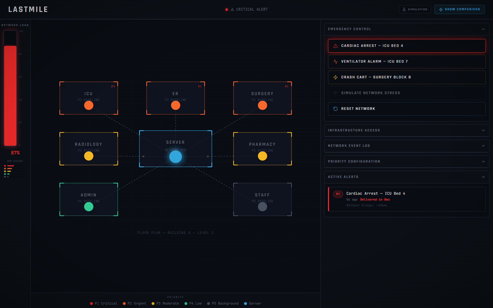
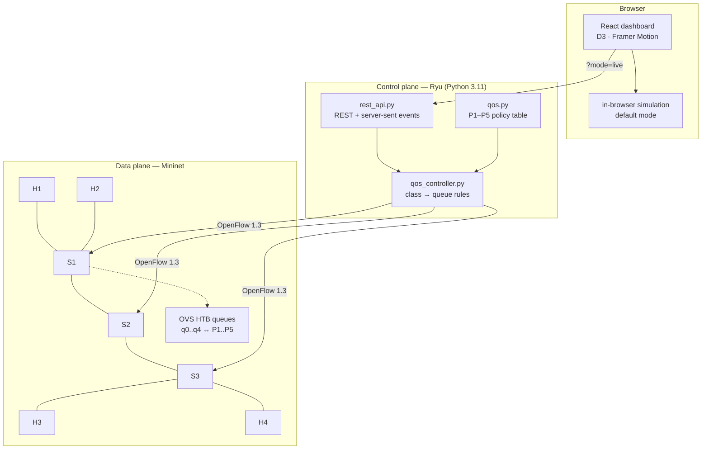

# LastMile Hospital

**Hospitals triage patients by urgency. LastMile triages packets the same way — an SDN controller that puts a cardiac alert ahead of a radiology upload.**

[](https://github.com/guru-bharadwaj20/LastMile-Hospital/actions/workflows/ci.yml)
[](SDN_files/qos_controller.py)
[](SDN_files/requirements.txt)
[](lastmile/package.json)
[](lastmile/tsconfig.json)
[](#what-ci-proves-on-every-push)
[](LICENSE)

Every hospital runs one shared network carrying cardiac arrest alerts,
ventilator alarms, ICU vitals, X-ray transfers, pharmacy orders, admin uploads
and staff WiFi. On a conventional network all of it is treated equally, so a
life-critical alert can sit behind an image upload at peak hours. LastMile
classifies traffic into five clinical priorities and enforces them in the data
plane with Open vSwitch HTB queues, with a dashboard that shows it happening.



<sub>A P1 cardiac alert crossing a network at 88% load. All stills are generated by `npm run demo:capture` — see [docs/DEMO.md](docs/DEMO.md).</sub>

---

## Contents

| Section | |
|---|---|
| [What it does](#what-it-does) | The two components, by area |
| [Architecture](#architecture) | Controller, switches, dashboard |
| [How an alert travels](#how-an-alert-travels) | Mark, classify, queue, deliver |
| [Quick start](#quick-start) | Dashboard alone, or the full stack |
| [Project status](#project-status) | Measured vs modelled, and what CI proves |
| [Design decisions](#design-decisions) | The tradeoffs, and why |
| [Limitations](#limitations) | Read this before quoting anything |
| [Repository layout](#repository-layout) | Where things live |
| [Documentation](#documentation) | Which file answers which question |
| [Team](#team) | Who built it |

---

## What it does

| Area | Capabilities |
|---|---|
| **Triage model** | Five classes from P1 (cardiac alerts, Code Blue) to P5 (staff WiFi, updates), each with a DSCP codepoint, an OpenFlow queue and an HTB rate guarantee |
| **Data plane** | Ryu controller installs OpenFlow 1.3 rules on Open vSwitch and emits a set-queue action per class |
| **Topology** | Mininet line topology (4 hosts, 3 switches); the forwarding table is derived from `topology.py`, not hand-written |
| **Benchmark** | `benchmark.py` drives background load, probes each class, and records latency percentiles with queues on and off |
| **REST + SSE** | `/lastmile/health`, `/policy`, `/topology`, `/status`, and a server-sent event stream of real switch counters |
| **Dashboard** | React 19 + D3 + Framer Motion: stress, cardiac alert, with/without comparison, node kill and restore, responsive to phone width |
| **Data sources** | Simulation by default, live counters with `?mode=live`, and an on-screen badge that always says which |
| **Delivery** | Docker Compose for the dashboard alone or the full stack; a GitHub Pages deploy workflow |

### Triage priority model

| Priority | Label | Traffic type | Behaviour under load |
|---|---|---|---|
| P1 | Critical | Cardiac alerts, Code Blue, crash cart | Guaranteed delivery, served ahead of all other traffic |
| P2 | Urgent | ICU vitals, ventilator alarms, surgery monitoring | High priority, minimal delay |
| P3 | Moderate | Lab results, imaging metadata, pharmacy orders | Standard priority |
| P4 | Low | Administrative uploads, EMR sync, reports | Throttled under stress |
| P5 | Background | Staff WiFi, visitor internet, software updates | First dropped under congestion |

---

## Architecture

A central SDN controller sees the whole topology and can reprogram every switch,
which is what makes "right now, give everything to this one packet" possible.



---

## How an alert travels

```mermaid
sequenceDiagram
    participant H as Bedside host
    participant S as Open vSwitch
    participant C as Ryu controller
    participant Q as HTB queue
    participant D as Dashboard

    C->>S: on connect: in_port + ipv4_dst + ip_dscp → SetQueue(n), Output
    C->>S: unmarked traffic → SetQueue(P5); table-miss → controller
    H->>S: packet marked DSCP 46 (EF) for P1
    S->>Q: enqueue in q0 (served first)
    Q-->>H: delivered ahead of P2–P5 traffic
    C->>D: SSE frame — queue counters, shares, link load
```

---

## Quick start

> The Mininet service needs `--privileged` and a Linux kernel with the
> `openvswitch` module. [docker/README.md](docker/README.md) sets out what works on
> which platform, and when not to trust a benchmark run.

```bash
# 1 — the dashboard alone, running the browser simulation
docker compose up --build dashboard            # http://localhost:8081

# 2 — the full stack: controller, emulated network, dashboard reading live counters
docker compose --profile sdn up --build        # http://localhost:8081/?mode=live

# 3 — everything CI runs
make check                                     # make help lists the rest
```

Without Docker:

```bash
# dashboard
cd lastmile && npm install && npm run dev      # http://localhost:5173

# controller (terminal 1) and topology (terminal 2)
ryu-manager --ofp-tcp-listen-port 6633 SDN_files/qos_controller.py SDN_files/rest_api.py
sudo mn --custom SDN_files/static_topo.py --topo statictopo \
  --controller remote,port=6633 --switch ovsk,protocols=OpenFlow13

# measure priority queuing, then regenerate the results table
sudo python3 SDN_files/benchmark.py --out results/qos_benchmark.csv
python3 SDN_files/report_results.py results/qos_benchmark.csv --update-readme
```

`--ofp-tcp-listen-port 6633` is required: current Ryu releases listen on 6653 by
default. The dashboard build honours `VITE_BASE_PATH` for subdirectory hosting,
and [deploy.yml](.github/workflows/deploy.yml) publishes it to GitHub Pages
(manual trigger) after lint, typecheck and tests pass.

---

## Project status

Every number here is labelled **measured** or **modelled**.

### Measured — the SDN layer

From `ping` and `iperf` against the Mininet topology on Open vSwitch; captures in
[SDN_files/Screenshots/](SDN_files/Screenshots/).

| Test | Result |
|---|---|
| Ping latency H1 → H3 | min 0.099 ms, avg 0.237 ms, max 0.629 ms |
| Ping latency H1 → H4 | min 0.069 ms, avg 0.184 ms, max 0.432 ms |
| iperf throughput H1 → H3 | 4.64 Gbit/s |
| iperf throughput H2 → H4 | 4.24 Gbit/s |
| Packet loss, normal operation | 0% |
| Packet loss, flow rule deleted | 100% |
| Regression test (routes stable after reinstall) | PASS |

These establish that the control plane works. They are not a measurement of
priority queuing under congestion.

### Measured — priority queuing

Generated from the benchmark CSV by
[report_results.py](SDN_files/report_results.py); no figure here is typed by hand.

<!-- BENCHMARK:START -->
_No benchmark results recorded yet._

Run the harness on a Mininet host and regenerate this section:

```bash
sudo python3 SDN_files/benchmark.py --out results/qos_benchmark.csv
python3 SDN_files/report_results.py results/qos_benchmark.csv --update-readme
```
<!-- BENCHMARK:END -->

### Modelled — the dashboard simulation

```
delivery_time(P1)     = 8 ms + jitter          // protected queue, load independent
delivery_time(Pn>1)   = base[Pn] + 2.8 × load% + jitter
delivery_time(no QoS) = 180 ms + 3.2 × load% + jitter
```

with `base = { P1: 8, P2: 25, P3: 80, P4: 180, P5: 250 }`
([engine.ts](lastmile/src/simulation/engine.ts),
[constants.ts](lastmile/src/simulation/constants.ts)). The curve shapes follow how
strict priority queuing behaves under congestion; **the constants are
illustrative, not empirical**. Replacing them with benchmark output is the open
roadmap item.

| Roadmap | Status |
|---|---|
| HTB queues and set-queue actions in the controller | ✅ |
| Benchmark harness with p50/p95/p99, queues on and off | ✅ built · ⏳ results not yet recorded |
| Controller REST + server-sent events, simulation kept as fallback | ✅ |
| Containerised reproduction | ✅ |
| Dashboard reporting measured instead of modelled numbers | ⏳ |

### What CI proves on every push

| Job | Proves |
|---|---|
| Dashboard (Node 20, 22) | ESLint, `tsc --noEmit`, 73 Vitest tests (engine, components, app, API client) and a production build |
| SDN layer (Python 3.11, 3.12) | `ruff` and 111 pytest tests — topology, flow table, QoS policy, API model, benchmark statistics, report generation |

`topology.py` and `flow_table.py` import neither Ryu nor Mininet, so routing is
verified on plain Python: all twelve ordered host pairs reachable by a shortest
path, with no blackholes, loops or ambiguous matches. `regression_test.py` drives
real switches and runs on the Mininet host.

---

## Design decisions

**Triage in the data plane, not the browser.** Priority is enforced by HTB
queues on the switches; the dashboard visualises it. A protected P1 queue
decouples critical latency from offered load.

**Guaranteed floors, not starvation.** Every class has an HTB minimum rate, so
P1 is served first without P5 ever being cut off entirely.

**Derive the forwarding table.** Rules come from `topology.py`, so the routing
logic is testable without a kernel, a switch or root.

**Server-sent events, not WebSockets.** The flow is one-way, the browser
reconnects on its own, and plain HTTP passes a lab proxy with no upgrade
handshake.

**Never show a simulated number under a LIVE label.** If the controller is
unreachable the dashboard shows an amber `CONTROLLER UNREACHABLE — SHOWING
SIMULATION` badge with a retry, rather than falling back silently.

**Generate the results, never type them.** The benchmark writes CSV and the
README section is regenerated from it, so the table cannot drift from a run.

---

## Limitations

> [!WARNING]
> **This is an emulation, not a hospital.** Mininet on one machine — namespaces,
> veth pairs and `tc` — says nothing about switch silicon with fixed buffers.
> Four hosts and three switches is a demonstration topology.
>
> **Classification trusts the endpoints.** Any host can mark its traffic P1 with one
> `setsockopt`. Edge policing of DSCP marks is not implemented.
>
> **The control plane is not secured.** OpenFlow runs over plain TCP, the REST API
> has no authentication and permissive CORS, and table-miss punts have no rate
> limit.
>
> **Not a medical device.** Nothing here is clinically validated or near an
> IEC 80001 process.
>
> **Ryu is unmaintained** and does not import on Python 3.12+; the controller
> containers pin 3.11, and [`os-ken`](https://opendev.org/openstack/os-ken) is the
> obvious migration.

Taking it further needs measured results on real switches, DSCP edge policing,
TLS and authentication, LLDP discovery, controller redundancy, and
subnet-matching rules that fit switch TCAM. See
[what breaks at scale](docs/ARCHITECTURE.md#what-breaks-at-scale) and the
[threat model](docs/ARCHITECTURE.md#threat-model).

---

## Repository layout

```
.
├── SDN_files/
│   ├── qos_controller.py · qos.py      class → queue policy and the Ryu app that enforces it
│   ├── rest_api.py · api_model.py      REST endpoints and the SSE status stream
│   ├── topology.py · flow_table.py     the topology and the forwarding table derived from it
│   ├── static_controller.py · static_topo.py   the original static-routing implementation
│   ├── benchmark.py · report_results.py        the queuing benchmark and its report generator
│   └── tests/                          pytest, no Ryu or Mininet needed
├── lastmile/src/
│   ├── simulation/                     constants, pure engine, React adapter
│   ├── api/                            controller client and live-link hook
│   └── components/                     map, alerts, load meter, comparison, node failure
├── docker/                             controller, mininet and dashboard images, nginx
├── results/                            benchmark CSV schema
└── docs/                               architecture, threat model, demo media
```

---

## Documentation

| Question | File |
|---|---|
| *Why was it built this way, and what breaks at scale?* | [docs/ARCHITECTURE.md](docs/ARCHITECTURE.md) |
| *How do I run the controllers and test scenarios?* | [SDN_files/README.md](SDN_files/README.md) |
| *What does a benchmark run establish?* | [results/README.md](results/README.md) |
| *Which platforms run the containers?* | [docker/README.md](docker/README.md) |
| *How is the dashboard structured?* | [lastmile/README.md](lastmile/README.md) |
| *How are the README visuals made?* | [docs/DEMO.md](docs/DEMO.md) |

References: [Mininet](https://mininet.org/overview/) ·
[Ryu](https://ryu-sdn.org/) ·
[OpenFlow](https://opennetworking.org/sdn-resources/openflow/) ·
[Open vSwitch](https://www.openvswitch.org/)

---

## Team

| Member | Focus |
|---|---|
| **Guru R Bharadwaj** | SDN controller and QoS policy, benchmark harness, dashboard, containers |

---

## License

[MIT](LICENSE).
